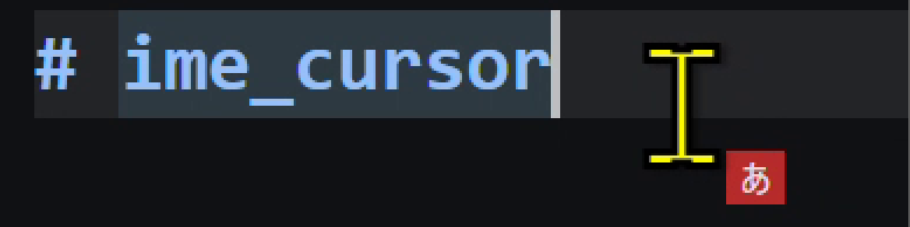
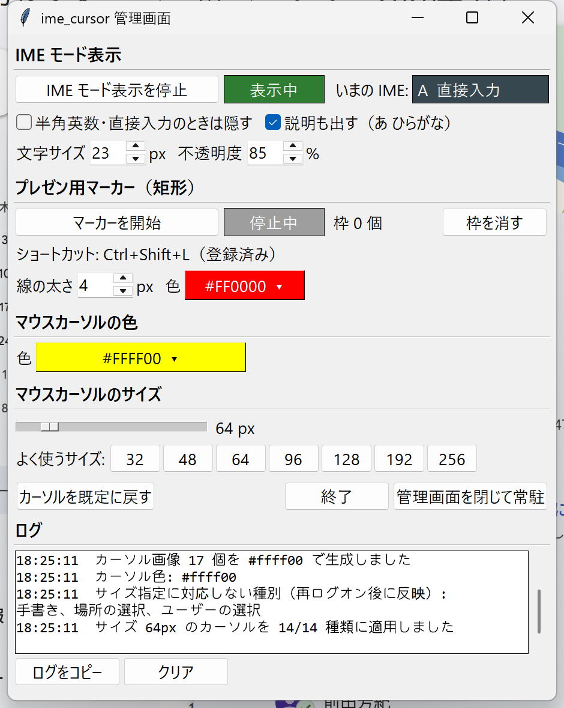

# ime_cursor

マウスカーソルの横に現在の IME の状態（ひらがな / カタカナ / 英数 など）を小さなバッジで表示し、あわせて**マウスカーソルの色とサイズ**、**プレゼン中に画面へ引くマーカー**も扱える Windows 常駐ツールです。設定は付属の**管理画面**から行います。

日本語 IME の状態は画面右下のタスクバーにしか出ないため、視線を大きく動かさないと確認できません。カーソルに追従するバッジを出すことで、入力中の視線のまま状態が分かるようにします。



エディタで日本語入力中の様子。マウスカーソル（Ｉビーム）の右下に「あ」のバッジが追従しています。

## できること

| 機能 | 内容 |
| --- | --- |
| IME モード表示 | カーソル追従バッジ。管理画面のボタンで**オン / オフ**を切り替え |
| マウスカーソルの色 | 色見本 8 色 + 任意の色（16 進で指定）。**実行中のアプリにも即座に反映** |
| マウスカーソルのサイズ | 32〜256 px をボタンで選ぶ。**実行中のアプリにも即座に反映** |
| コピー通知 | クリップボードに入ったら、カーソルの近くに「コピーしました」を数秒出す |
| プレゼン用マーカー | `Ctrl+Shift+L` でモードに入り、ドラッグで画面に赤い枠を描く |
| 既定に戻す | ツールを使う前のカーソル設定をそのまま復元 |

## 特徴

- **依存パッケージゼロ** — Python 標準ライブラリ（`ctypes` + `tkinter` + `winreg`）のみ
- **管理者権限不要** — 書き換えるのは `HKEY_CURRENT_USER` 配下だけ
- **再ログオン不要** — 色もサイズも、すでに起動しているアプリに即座に効く
- **クリックスルー** — バッジの上でも普通にクリックできる（マウス操作を一切邪魔しない）
- **フォーカスを奪わない** — `WS_EX_NOACTIVATE` 指定なので、入力中のアプリのフォーカスは維持される
- **高 DPI 対応** — Per-Monitor v2。複数ディスプレイ・スケーリング混在でも位置がズレず、文字の大きさもモニタごとの拡大率に合わせる
- **ちらつき防止** — ウィンドウ切り替え中などに IME への問い合わせが一瞬失敗しても、直前の状態を保持する
- **元に戻せる** — 変更前のレジストリ値を退避してから適用する

## 動作環境

| 項目 | 内容 |
| --- | --- |
| OS | Windows 10 / 11 |
| Python | 3.10 以上（tkinter 同梱のもの） |
| 追加インストール | 不要 |

Microsoft Store 版 Python 3.13（tkinter 8.6 同梱）で動作を確認しています。

## 起動

### ダブルクリック

エクスプローラーで **`ime_cursor.pyw`** をダブルクリックすると、管理画面が開いて常駐します。`.pyw` は `pythonw.exe` に関連付けられているため、コンソール（黒い窓）は表示されません。

**常駐中にもう一度ダブルクリックすると、管理画面が前面に戻ってきます。** 多重起動にはならないので、管理画面を閉じたあとの呼び出しはこの操作で行ってください。

### コマンドから

```
pythonw ime_cursor.pyw                 管理画面を出して常駐する
pythonw ime_cursor.pyw --silent        管理画面を出さずに常駐する（自動起動向け）
python  ime_cursor.pyw --debug         GUI を出さず IME 状態をコンソールに出す
python  ime_cursor.pyw --reset-cursor  カーソルの色とサイズを既定に戻して終了する
python  ime_cursor.pyw --help          使い方を出す
```

### 自動起動（ログオン時）

1. `Win+R` → `shell:startup` を開く
2. `ime_cursor.pyw` のショートカットをそのフォルダに置く
3. ショートカットのリンク先の末尾に ` --silent` を足す（起動時に管理画面を出さない）

保存済みの色とサイズは、起動時に自動で適用し直されます（「[サイズが効く仕組み](#マウスカーソルのサイズ)」の理由から、サイズはサインアウトで失われるため）。

## 管理画面



### IME モード表示

管理画面は「IME モード表示」「コピー通知」「プレゼン用マーカー」「マウスカーソルの色」「マウスカーソルのサイズ」「ログ」の順に、見出しと罫線で区切られています。

| 操作 | 内容 |
| --- | --- |
| **IME モード表示を開始 / 停止** | バッジのオン / オフ。押すとその場でマウスカーソル付近に出る / 消える |
| 表示中 / 停止中 | 現在の状態 |
| いまの IME | バッジと同じ内容を管理画面上でも確認できる |
| 半角英数・直接入力のときは隠す | 日本語入力中だけバッジを出したいとき |
| 説明も出す | 「あ」ではなく「あ ひらがな」と出す |
| 文字サイズ / 不透明度 | バッジの見た目 |

### コピー通知

| 操作 | 内容 |
| --- | --- |
| クリップボードにコピーしたら、カーソルの近くに知らせる | 通知のオン / オフ。既定はオン |
| コピーした内容の先頭も出す | 「コピーしました: 山本 裕吾…」のように先頭 24 文字を添える。既定はオン |
| 表示時間 | 通知を出しておく時間（300〜10000 ミリ秒）。既定は 1400 |
| 文字サイズ | 8〜72 px。既定は 15。**高 DPI のディスプレイでは拡大率を掛けた大きさで出ます**（200% なら 30 px 相当） |
| テスト表示 | その場で 1 回出す。見え方や表示時間の確認用 |

詳しくは「[コピー通知](#コピー通知)」を参照してください。

### マウスカーソルの色

**いまの色が出ているラベル（`#FFFF00 ▾`）をクリック**するとポップアップが開きます。色見本を押せばその場で決まり、`16 進` の欄に `#ff8800` のように書いても指定できます（`#` 抜きや `#f80` の 3 桁でも通ります）。「詳しく…」で Windows 標準の色ダイアログも開けます。

ポップアップの「Windows の設定のまま」を選ぶと、色だけを Windows の設定に返します（サイズの指定は残ります）。

### マウスカーソルのサイズ

ボタンで 32 / 48 / 64 / 96 / 128 / 192 / 256 px から選びます。押すとその場で適用され、右に現在のサイズが出ます。

### プレゼン用マーカー（矩形）

| 操作 | 内容 |
| --- | --- |
| **マーカーを開始 / 停止** | 管理画面のボタン。`Ctrl+Shift+L` と同じ |
| 色（`#FF0000 ▾`） | クリックするとポップアップが開く。既定は赤 |
| 線の太さ | 1〜32 px。既定は 4 px |
| モード中に左上へ操作説明を出す | 既定はオン。慣れたら切れる |
| 枠を消す | 描いた枠を全部消す（モードは続く） |

詳しい使い方は「[プレゼン用マーカー](#プレゼン用マーカー)」を参照してください。

### 下部のボタン

| ボタン | 内容 |
| --- | --- |
| カーソルを既定に戻す | 色とサイズを、このツールを初めて使う前の状態に戻す |
| 管理画面を閉じて常駐 | ウィンドウを隠す。バッジと常駐は続く（× ボタンも同じ動作） |
| 終了 | 常駐を終了する。カーソルの設定はそのまま残る |

### ログ

適用した内容や失敗した理由が時刻付きで並びます。**「ログをコピー」**でクリップボードに入るので、うまく動かないときはそのまま貼り付けて共有できます。

## プレゼン用マーカー

プレゼン中に画面の一部を赤い枠で囲んで指し示す機能です。常駐していればいつでも使えます。

| 操作 | 内容 |
| --- | --- |
| `Ctrl+Shift+L` | マーカーモードの開始 / 終了 |
| マウスドラッグ | 赤い枠を描く。複数を重ねて描ける |
| `Escape` | 枠を全部消して、マーカーモードも終了する |
| 右クリック | 同じ（緊急脱出用） |

枠はマーカーモードと同じ寿命です。モードを抜けると消えます。

### モード中にできること・できないこと

**キーボードは下のアプリに残ります。** マーカーモード中でも、矢印キー・スペース・プレゼンリモコンでそのままスライドを送れます。フォーカスを奪わない実装（`WS_EX_NOACTIVATE`）にしているためです。

一方**マウスのクリックは下のアプリに渡りません。** これは意図的で、PowerPoint のスライドショーは左クリックでページが進むため、枠を描くたびにスライドが進んでしまうのを防いでいます。モード中はクリックでスライドを送れないので、送りたいときはキーボードを使うか、`Ctrl+Shift+L` でモードを抜けてください。

モード中は画面が 2% ほど暗くなり、左上に操作方法が出ます。これがモードに入っている目印です。操作説明は管理画面の「モード中に左上へ操作説明を出す」で切れます（画面を録画するときなどに）。切っても画面の暗さは残るので、モードに入っているかは分かります。

### ショートカットが効かないとき

他のアプリが `Ctrl+Shift+L` を握っていると登録に失敗します。管理画面のマーカー欄に理由が出るので、設定ファイルの `marker_hotkey` を空いている組み合わせに変えて、常駐を再起動してください。

```json
"marker_hotkey": "ctrl+alt+m"
```

指定できるのは `ctrl` / `shift` / `alt` / `win` の組み合わせと、英数字 1 文字・`f1`〜`f12`・`escape`・`space` です。

`marker_hotkey_enabled` を `false` にしてショートカットを切った場合も、管理画面のボタンで開始できます。このときも**モード中の `Escape` と右クリックは使えます**（切り替えのショートカットとは別に、モード中だけ `Escape` を登録しているため）。

### 万一固まったとき

マーカーモード中は画面全体のクリックを受け取るため、プロセスが固まるとマウスが効かなくなります。`Escape`・右クリック・`Ctrl+Shift+L` のいずれでも抜けられますが、それでも駄目な場合は「[終了](#終了)」のコマンドでプロセスを終了させてください。

## コピー通知

`Ctrl+C` を押しても、本当にコピーできたのか分からないことがあります（選択が外れていた、フォーカスが別のペインにあった、アプリが `Ctrl+C` を握っていた）。クリップボードに入ったときだけカーソルの近くに通知を出すので、**通知が出なければコピーされていない**と分かります。

通知の大きさは**カーソルのあるモニタの拡大率に合わせます**。拡大率の違うモニタが混在していても、見た目の大きさは同じになります。大きさが好みでなければ、管理画面の「文字サイズ」で変えてください。

見出し（`コピーしました:`）は緑、コピーした中身は白の太字と、色を分けています。状態と中身がひと目で切り分けられるようにするためです。

| コピーしたもの | 通知 |
| --- | --- |
| テキスト | `コピーしました: 先頭の24文字…` |
| 画像 | `画像をコピーしました` |
| ファイル（エクスプローラ） | `ファイルをコピーしました` |
| 中身を読めなかったとき | `コピーしました` |

`Ctrl+C` 以外でも、右クリック →「コピー」でも、他のアプリやクリップボード履歴による書き込みでも出ます。「クリップボードが変わった」ことを見ているためです。`Ctrl+X`（切り取り）も「コピーしました」と出します（クリップボードに入ったことが要点のため）。

通知はクリックスルーで、フォーカスも奪いません。入力中に `Ctrl+C` を押しても、続けて打った文字はそのままアプリに入ります。

**パスワードは中身を出しません。** パスワードマネージャなどが「監視するな」の印（`ExcludeClipboardContentFromMonitorProcessing` / `Clipboard Viewer Ignore` フォーマット）を載せている場合、中身は一切読まずに「コピーしました」だけを出します。その印を出さないアプリが気になる場合は、管理画面の「コピーした内容の先頭も出す」を切ってください。

## 終了

管理画面の「終了」ボタンで終了できます。管理画面を出していないときは、プロセスを終了させます。プロセスの**コマンドライン**にスクリプトのパスが入っているため、それを条件にこのスクリプトだけを狙って終了できます。

```
powershell -NoProfile -Command "Get-CimInstance Win32_Process | Where-Object { $_.CommandLine -like '*ime_cursor.pyw*' } | ForEach-Object { Stop-Process -Id $_.ProcessId -Force }"
```

他の `.pyw` スクリプトを `pythonw` で常駐させていても、それらは終了しません。

タスクマネージャーから終了する場合は、「詳細」タブで列見出しを右クリック →「列の選択」→「コマンド ライン」にチェックを入れてください。どの `pythonw` がこのスクリプトなのか判別できます。

`taskkill /im pythonw.exe` のようなプロセス名だけの指定は使わないでください。他の `.pyw` スクリプトを巻き添えにするうえ、プロセス名は Python の導入方法によって `pythonw.exe` / `pythonw3.13.exe` と変わるため、そもそも当たらないことがあります。

## 設定ファイル

管理画面での変更は自動保存されます。手で編集する場合は、常駐を終了してから書き換えてください。

```
%USERPROFILE%\.ime_cursor\config.json     設定
%USERPROFILE%\.ime_cursor\cursors\*.cur   生成したカーソル画像
```

| キー | 既定値 | 説明 |
| --- | --- | --- |
| `badge_enabled` | `true` | IME モード表示のオン / オフ |
| `hide_alnum` | `false` | 半角英数・直接入力のときはバッジを隠す |
| `verbose` | `false` | 「あ ひらがな」のように説明も表示する |
| `font_size` | `16` | バッジの文字サイズ（px、96dpi 換算）。高 DPI では拡大率を掛ける |
| `alpha` | `0.85` | 不透明度（0.0 = 透明 〜 1.0 = 不透明） |
| `offset_x`, `offset_y` | `20`, `20` | カーソルからの表示オフセット（px）。負の値でカーソルの左上に出せる |
| `follow_cursor_size` | `true` | カーソルが大きいとき、オフセットも比例して広げる |
| `interval_ms` | `30` | 位置と状態の更新間隔（ミリ秒）。小さいほど追従が滑らかで、CPU 使用率は上がる |
| `clip_notice_enabled` | `true` | コピー通知のオン / オフ |
| `clip_notice_preview` | `true` | コピーした内容の先頭も出すか |
| `clip_notice_ms` | `1400` | 通知を出しておく時間（ミリ秒、300〜10000） |
| `clip_font_size` | `15` | 通知の文字サイズ（px、8〜72）。高 DPI では拡大率を掛ける |
| `cursor_color` | `null` | カーソルの色（`"#00a0ff"` 形式）。`null` なら Windows の設定のまま |
| `cursor_size` | `32` | カーソルのサイズ（px、32〜256） |
| `marker_hotkey_enabled` | `true` | マーカーのホットキーを登録するか |
| `marker_hotkey` | `"ctrl+shift+l"` | マーカーモードの切り替え |
| `marker_color` | `"#ff0000"` | 枠の色 |
| `marker_width` | `4` | 枠の太さ（px、1〜32） |
| `marker_catch_alpha` | `0.02` | マーカーモード中の画面の暗さ（0.01〜0.30） |
| `marker_show_indicator` | `true` | マーカーモード中に左上へ操作説明を出すか |
| `cursor_backup` | `{}` | 初回適用時のレジストリ値。「既定に戻す」で使う。**消さないこと** |
| `admin_geometry` | `""` | 前回の管理画面の位置 |

なぜ `%APPDATA%` ではなくユーザーフォルダ直下かというと、Microsoft Store 版 Python は `%APPDATA%` / `%LOCALAPPDATA%` への書き込みをパッケージ配下の `LocalCache` に転送してしまうためです。生成したカーソルのパスはレジストリに書いて他のプロセスから開かせる必要があるので、転送されない場所に置いています。

## 表示

| IME の状態 | バッジ | 背景色 |
| --- | --- | --- |
| ひらがな | あ | 赤 |
| 全角カタカナ | カ | 橙 |
| 半角カタカナ | ｶ | 橙 |
| 半角ひらがな | ｱ | 橙 |
| 全角英数 | Ａ | 緑 |
| 半角英数 | A | 灰 |
| 直接入力（IME オフ） | A | 灰 |
| 取得できず | ? | 紫 |

## 仕組み

### IME 状態の取得

1. `GetForegroundWindow` → `GetGUIThreadInfo` で、入力フォーカスを持つウィンドウを特定する
2. `ImmGetDefaultIMEWnd` で、そのウィンドウに対応する IME ウィンドウのハンドルを得る
3. `SendMessageTimeoutW` で `WM_IME_CONTROL` を送る
   - `IMC_GETOPENSTATUS` → IME のオン / オフ
   - `IMC_GETCONVERSIONMODE` → 変換モードのビットフラグ

変換モードのビット（`IME_CMODE_NATIVE` / `KATAKANA` / `FULLSHAPE`）の組み合わせから、ひらがな・カタカナ・全角英数などを判定します。

フォーカス側のウィンドウから取得できない場合は前面ウィンドウにフォールバックし、それでも失敗した場合は直前の状態を最大 8 回分だけ保持します（表示のちらつき防止）。

`SendMessageTimeoutW` に `SMTO_ABORTIFHUNG` とタイムアウト 120ms を指定しているため、応答しないアプリが前面にあってもツールが固まることはありません。

### オーバーレイ表示

tkinter のトップレベルウィンドウに、`SetWindowLongPtrW` で以下の拡張スタイルを付けています。

| スタイル | 目的 |
| --- | --- |
| `WS_EX_LAYERED` | 半透明表示 |
| `WS_EX_TRANSPARENT` | クリックスルー（マウス操作を透過させる） |
| `WS_EX_NOACTIVATE` | クリックされてもフォーカスを奪わない |
| `WS_EX_TOOLWINDOW` | Alt+Tab とタスクバーに出さない |

`interval_ms` ごとに `GetCursorPos` を読み、`GetSystemMetrics(SM_*VIRTUALSCREEN)` で仮想デスクトップの範囲にクランプしてから移動します。カーソルを大きくしているときはバッジがカーソルの下に隠れるため、`follow_cursor_size` が有効ならオフセットも比例して広げます。

文字の大きさは、そのときカーソルがあるモニタの拡大率（`MonitorFromPoint` + `GetDpiForMonitor`）を掛けて決めます。Per-Monitor v2 のプロセスでは Tk の 1 ピクセルが物理ピクセルなので、`font_size` をそのまま px で渡すと 200% のディスプレイでは半分の大きさに見えてしまうためです。**設定値は 96dpi 換算**で、拡大率の違うモニタへカーソルを移すとその場で測り直します。バッジ・マーカーの操作説明・コピー通知のすべてが同じ扱いです。

### マウスカーソルの色

Windows は「マウスポインターの色」を `%SystemRoot%\cursors\*.svg` からその場でレンダリングし、`%LOCALAPPDATA%\Microsoft\Windows\Cursors\*_eoa.cur` に書き出しています。**レジストリの `CursorColor` を書き換えるだけでは何も起こりません**（`SPI_SETCURSORS` はレジストリが指すファイルを読み直すだけで、画像を再生成しない）。

そこで、Windows 自身と同じことを自前でやります。

- 「Windows Aero」スキームの `aero_*.cur` / `aero_*.ani` は、白い本体と黒い縁取りだけのグレースケール画像になっている
- 各ピクセルの輝度に目的の色を掛ければ、白 → 指定色 / 黒 → 黒 となり、Windows 純正の着色結果と一致する
  （実測: 輝度 255 × 色 250 ÷ 255 = 250、輝度 96 → 94 と Windows の出力に一致）
- `.ani` は RIFF/ACON なので、`icon` チャンクごとに同じ処理をかける
- Aero スキームはテキストカーソルと十字カーソルを持たない（OS 内蔵のモノクロ版が使われる）ため、この 2 つだけは同じ見た目になるよう自前で描く

着色は `bytes.translate` による変換表 1 回で済むので、17 種類ぶんで 0.2 秒ほどです。生成したファイルは `%USERPROFILE%\.ime_cursor\cursors\` に置き、レジストリの `HKCU\Control Panel\Cursors` からそこを指させます。

Windows 側の配色機能（`HKCU\Software\Microsoft\Accessibility\CursorType`）は 0 に倒します。有効なままだと、再ログオン時にこちらのスキームが上書きされることがあるためです。

### マウスカーソルのサイズ

`HKCU\Control Panel\Cursors\CursorBaseSize` を書いて `SPI_SETCURSORS` を投げる、というよく紹介される方法では**すでに起動しているアプリのカーソルは大きくなりません**。`SM_CXCURSOR` がプロセス起動時にキャッシュされるためです（実測: `CursorBaseSize` を 32 → 96 → 256 と変えても、同一プロセスから見た `SM_CXCURSOR` は 64 のまま）。

そこで、寸法を直接指定してカーソルを載せ替えます。

1. `LoadImageW(NULL, パス, IMAGE_CURSOR, 幅, 高さ, LR_LOADFROMFILE)` で、指定サイズのカーソルを読み込む
2. `SetSystemCursor(ハンドル, OCR_*)` でセッション全体に載せる

これは即座に、全プロセスに効きます。ファイルの指定がない種別（Aero スキームのテキスト・十字カーソル）は、`LoadCursorW` + `CopyImage` で OS 内蔵カーソルの指定サイズのコピーを作って使います。

`SetSystemCursor` で差し替えられるのは標準の 14 種類（`OCR_NORMAL` など）です。手書き・場所の選択・ユーザーの選択の 3 種類には対応する `OCR_*` が無いため、こちらはレジストリ経由（再ログオン後に反映）になります。

`SetSystemCursor` の効果はサインアウトすると失われるので、`CursorBaseSize` も併せて書いて再ログオン後の初期値をそろえ、さらに常駐プロセスの起動時に設定を適用し直します。

### マーカーの重ね方

「描いた枠だけが見えて、それ以外は下のアプリが見える」と「マウスのドラッグを奪う」を 1 枚のウィンドウでは同時に満たせません。Windows のレイヤードウィンドウの当たり判定が理由です（いずれも実測）。

- **カラーキー透過**（`LWA_COLORKEY` / Tk の `-transparentcolor`）は、キー色のピクセルが**当たり判定も透過する**。見た目は完璧だがドラッグを拾えない
- **一律アルファ**（`LWA_ALPHA` / Tk の `-alpha`）は、どれだけ薄くしても**当たり判定を透過しない**。ただしアルファは窓全体に一律にかかるので、薄くすると赤い枠まで薄くなる（`0.0` だけは完全透過とみなされて当たり判定が抜けるため、下限を `0.01` に丸めている）

そこで役割を 2 枚に分けています。

| 層 | 見た目 | 入力 | 拡張スタイル |
| --- | --- | --- | --- |
| 描画層 | キー色 `#010203` を透過。枠だけ不透明 | 一切拾わない | `LAYERED` `TRANSPARENT` `NOACTIVATE` `TOOLWINDOW` |
| 入力層 | ほぼ透明。モード中の目印にもなる | ドラッグを全部拾って飲み込む | `LAYERED` `NOACTIVATE` `TOOLWINDOW` |

描画層に `WS_EX_TRANSPARENT` を付けているのは、キー色は当たり判定が抜けても**描いた線の上だけは当たり判定が残ってしまう**ためです。付けないと枠の上でクリックが死にます。逆に入力層に付けてはいけません（ドラッグを拾えなくなる）。

### クリップボードの監視

`GetClipboardSequenceNumber` を 120 ミリ秒ごとに読み、前回と違えば通知を出します（セッションごとの `DWORD` で、クリップボードが書き換わるたびに増えます。折り返すので大小ではなく「違うか」だけを見ます）。

Windows には `AddClipboardFormatListener` + `WM_CLIPBOARDUPDATE` という正式なイベント通知もありますが、**自前の `WndProc` を持つ `HWND` が必要**です。Tk のトップレベルの `WndProc` は Tcl/Tk のもので `SetWindowLongPtr` による差し替えは壊れやすく、避けるならメッセージ専用ウィンドウ（`HWND_MESSAGE`）を別スレッドに立てることになります。sequence number なら 1 回あたり user32 の呼び出し 1 回で済み、**クリップボードを開かない**ので他アプリのコピーを邪魔しません。

中身の判定も `IsClipboardFormatAvailable`（開かずに答えられる）だけで済ませ、`CF_HDROP` → ファイル、`CF_BITMAP` / `CF_DIB` → 画像、`CF_UNICODETEXT` → テキストと見ます。プレビューを出すときだけ `OpenClipboard` し、`GlobalLock` したメモリから**先頭 49 文字だけ**を `wstring_at` で読んで、すぐ閉じます（数 MB のコピーでも一定の速さで済ませるため。開きっぱなしにすると他アプリのコピーが壊れます）。他アプリが開いている最中は `OpenClipboard` が失敗するので、20 ミリ秒だけ待って 1 回だけ再試行し、それでも駄目なら「コピーしました」だけを出します。

Office のように 1 回のコピーでフォーマットを段階的に載せるアプリでは sequence が数回増えるため、400 ミリ秒以内の変化は出し直さずに表示時間だけ延ばしています。

通知の大きさは、出す直前に `MonitorFromPoint` + `GetDpiForMonitor` でカーソルのあるモニタの拡大率を取り、文字と余白に掛けています。Per-Monitor v2 のプロセスでは Tk の 1 ピクセルが物理ピクセルなので、px 指定のままだと 200% のディスプレイで半分の大きさに見えてしまうためです（`clip_font_size` は 96dpi 換算の値）。拡大率の違うモニタへカーソルを移しても、出すたびに測り直します。

### ホットキーの受け取り方

`RegisterHotKey` に `hwnd=NULL` を渡すと `WM_HOTKEY` は**スレッドのメッセージキュー**に積まれます。tkinter のメッセージポンプはスレッドメッセージも `GetMessage` で拾ってしまうものの、`hwnd` が `NULL` なので `DispatchMessage` が何もせずに捨ててしまいます。**Tk のイベントループで待っていても永久に届きません。**

そのため登録と `GetMessageW` ループを専用スレッドに閉じ込め、押されたことだけを `queue.Queue` 経由で Tk 側へ渡しています（`RegisterHotKey` とメッセージループは同じスレッドである必要があります）。`Escape` はモード中だけ登録し、抜けるときに解除します（常時登録すると他アプリの `Escape` を奪ってしまう）。

### フォーカスを奪わない工夫

Tk はウィンドウを作るときと `deiconify()` / `lift()` のときに `ShowWindow(SW_RESTORE)` 相当を呼ぶため、`WS_EX_NOACTIVATE` を付けていても**その瞬間だけフォアグラウンドを奪ってしまいます**（実測）。プレゼン中にこれが起きると下のアプリのキーボード操作が切れるので、

- 表示・非表示は Tk ではなく `ShowWindow(SW_SHOWNA)` / `SW_HIDE` で直接行う
- `lift()` は使わない（後から表示した方が上に来るので不要）
- ウィンドウ生成自体もフォアグラウンドを奪うため、**生成より先に**前面のウィンドウを覚えておき、表示し終えたら `SetForegroundWindow` で返す

としています。

### 元に戻す仕組み

初めて色・サイズを適用する直前に、`HKCU\Control Panel\Cursors` の 17 種類のパス・`CursorBaseSize`・`Scheme Source`・スキーム名と、`HKCU\Software\Microsoft\Accessibility` の `CursorType` / `CursorColor` を読み出し、`config.json` の `cursor_backup` に退避します。「カーソルを既定に戻す」はこれを書き戻し、`SPI_SETCURSORS` でレジストリから読み直させます（`SetSystemCursor` で載せたものもここで捨てられます）。

退避を取り直すときに自前の生成先を指しているエントリは「値なし（削除）」として扱うので、`config.json` を消してしまっても、自前のカーソルが「元の状態」として記録されることはありません。

管理画面が開けない状況では、コマンドラインから戻せます。

```
python ime_cursor.pyw --reset-cursor
```

## ファイル構成

```
ime_cursor.pyw          起動用（ダブルクリックする対象）
imecursor/
  win32.py              Win32 API (ctypes) の共通定義
  imestate.py           IME の状態取得
  config.py             設定ファイルの読み書き
  curfile.py            .cur / .ani の着色と生成
  cursortheme.py        カーソルの色・サイズの適用（レジストリ）
  overlay.py            カーソル追従バッジ
  colorpicker.py        色を選ぶポップアップ (16 進入力 + 色見本)
  hotkey.py             グローバルホットキーの待ち受け (専用スレッド)
  marker.py             プレゼン用マーカー (描画層 + 入力層)
  clipnotice.py         コピー通知 (クリップボード監視 + トースト)
  admin.py              管理画面 (tkinter)
  app.py                起動制御（単一インスタンス・コマンドライン引数）
```

多重起動すると同じバッジが 2 枚重なるため、名前付きミューテックスで 1 プロセスに制限しています。2 回目以降の起動は目印ファイル（`%USERPROFILE%\.ime_cursor\show_admin.flag`）を置いてすぐ終了し、常駐している側がそれを見て管理画面を出します。

## デバッグ

`--debug` を付けると、GUI を出さずに状態遷移だけをコンソールへ出力します。このときは `pythonw` ではなく `python` で起動してください（`pythonw` は `sys.stdout` が `None` になり、`print()` が破棄されるため）。

```
python ime_cursor.pyw --debug
```

```
IME 状態を監視中 (Ctrl+C で終了)
あ  ひらがな     open=1 mode=0x09
A  直接入力     open=0 mode=0x00
```

`mode` は `IMC_GETCONVERSIONMODE` の生の値なので、判定がおかしいときはこの値を見てください。

カーソル関係の不調は、管理画面のログ欄に理由が出ます。「ログをコピー」で持ち出せます。

## トラブルシューティング

**バッジが「?」のまま**
IME ウィンドウが取得できていません。UWP アプリなど IMM32 を経由しない一部のアプリが前面にあると発生することがあります。別のアプリにフォーカスを移すと復帰します。

**ダブルクリックしても何も起きない**
`.pyw` が `pythonw.exe` に関連付けられていない可能性があります。次のコマンドで確認してください。

```
reg query "HKCU\Software\Classes\.pyw"
```

関連付けが無い場合は `pythonw ime_cursor.pyw` で直接起動するか、`pythonw.exe` を指すショートカットを作成してください。

**管理画面が見つからない**
`ime_cursor.pyw` をもう一度ダブルクリックすると前面に出ます。

**カーソルの色が一部だけ変わらない**
手書き・場所の選択・ユーザーの選択のカーソルは `SetSystemCursor` で差し替えられないため、反映は再ログオン後になります。

**サインアウトしたらカーソルのサイズが変わった**
`SetSystemCursor` の効果はセッション内だけです。常駐プロセスを自動起動に登録しておけば、ログオン時に適用し直されます。

**カーソルを元に戻したい**
管理画面の「カーソルを既定に戻す」、または `python ime_cursor.pyw --reset-cursor` を使ってください。

**マーカーモード中にクリックでスライドが送れない**
意図した動作です。左クリックはマーカーが飲み込んでいます。キーボードなら送れます。`Ctrl+Shift+L` でモードを抜ければクリックも戻ります。

**`Ctrl+Shift+L` が効かない**
他のアプリが握っています。管理画面のマーカー欄に理由が出ます。`marker_hotkey` を変えてください。

**バッジの位置がカーソルとズレる**
Per-Monitor v2 の DPI 認識に失敗している可能性があります。`offset_x` / `offset_y` で調整してください。

## WSL から使う場合

スクリプトを WSL 側に置いたままでも、UNC パス経由で Windows の `pythonw.exe` から実行できます。

```bash
powershell.exe -NoProfile -Command "Start-Process pythonw -ArgumentList '\\wsl.localhost\<ディストリ名>\<スクリプトのパス>\ime_cursor.pyw'"
```

## 補足

`# /// script` の PEP 723 ヘッダを残してあるため、`uv run ime_cursor.pyw` でも起動できます。ただし `uv.exe` はコンソールアプリのため、ショートカットから起動すると黒い窓が出たままになります。uv を使う場合は、コンソールを持たない `uvw.exe` を利用してください。
